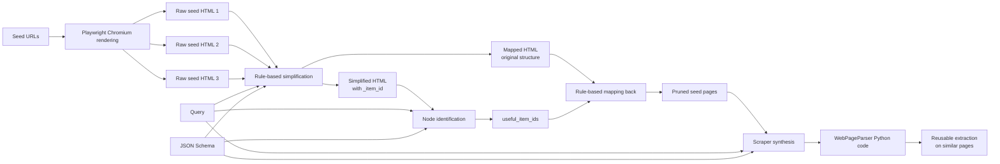

<div align="center">

# Co-Scraper

**Query-aware DOM pruning and reusable scraper synthesis for lightweight web data extraction**

[](LICENSE)
[](pyproject.toml)
[](https://github.com/Ambition-0303/Co-Scraper/actions/workflows/ci.yml)
[](pyproject.toml)
[](https://anonymous-hf.com/a/mu3yikgac8ng/)

</div>

---

## ✨ Why Co-Scraper?

Modern web pages are long, noisy, and structurally inconsistent. Asking an LLM to
read an entire raw DOM is expensive and error-prone. Co-Scraper separates the problem
into two robust stages:

1. **Query-aware DOM pruning** — identify content blocks relevant to a query while
   preserving the original hierarchy needed for reliable XPath generation.
2. **Reusable scraper synthesis** — compare three pruned seed pages and generate a
   deterministic Python parser that can be reused without additional LLM calls.

The result is a small, explainable pipeline that turns a natural-language query and
schema into executable extraction code.

---

## 🚀 Highlights

- **Query-aware pruning**: removes navigation, scripts, styles, invisible nodes, and unrelated content while retaining answer nodes and useful context.
- **Structure-preserving mapping**: simplified HTML and mapped HTML remain synchronized through stable `_item_id` values.
- **Three-seed induction**: compares three pages to distinguish stable structure from page-specific noise.
- **Reusable output**: emits a `WebPageParser` class with a `parse(html_text) -> dict` interface.
- **URL rendering**: accepts three local HTML files or HTTP(S) URLs and renders URLs with Playwright.
- **Automatic execution**: runs the generated parser on the three seed pages and saves the results.
- **OpenAI-compatible**: works with local vLLM, private gateways, or hosted APIs.
- **No bundled benchmark data**: SWDE and LiveWeb-IE remain separate; no test data or private outputs are redistributed.

---

## 🤗 RWDE dataset

RWDE contains 184 sites, 462 page-structure groups, and 643 extraction queries. It
provides raw and processed HTML, reference XPath locators, node-identification
artifacts, generated scraper samples, item-level annotations, and field-level ground
truth for both SFT and RFT. The dataset is released under CC BY 4.0; third-party
webpage content remains subject to the rights and terms of its original owners.

---

## 🧭 How it works



### Pipeline stages

1. **URL rendering** uses Playwright Chromium when an input is an HTTP(S) URL; local HTML files are loaded directly.
2. **Pre-processing** removes scripts, styles, resource links, invisible elements, and noisy attributes.
3. **Block segmentation** converts mixed text/tag structures into content blocks.
4. **Stable IDs** attach `_item_id` values to simplified and mapped representations.
5. **Node identification** asks the model to return `useful_item_ids` for answer and support nodes.
6. **Mapping back** preserves useful subtrees, ancestors, short structural siblings, and compacts irrelevant subtrees.
7. **Scraper synthesis** uses the three pruned pages, query, and schema to generate XPath-based Python code.
8. **Execution** runs the generated parser on the three seed pages and records each result.
9. **Reuse** executes the same parser directly on new pages from the same structural group.

---

## 📦 Installation

Install from source:

```bash
git clone https://path/to/Co-Scraper.git
cd Co-Scraper
python -m venv .venv
source .venv/bin/activate
pip install -e .
```

For development:

```bash
pip install -e ".[dev]"
```

To render seed pages from URLs, install the browser extra and Chromium:

```bash
pip install -e ".[browser]"
playwright install chromium
```

On a minimal Linux system, install Chromium runtime libraries if browser launch fails:

```bash
playwright install-deps chromium
```

Requirements:

- Python 3.10+
- `lxml`
- An OpenAI-compatible chat-completions endpoint
- Playwright and Chromium, only when using URL inputs

---

## ⚡ Quick start

### 1. Prepare three seed pages

Use three pages from the same website or structurally similar template. Inputs can be
local HTML files or HTTP(S) URLs. The examples in [`examples/`](examples) contain three
synthetic camera product pages.

### 2. Define the output schema

```json
{
  "type": "object",
  "properties": {
    "model": {"type": "string"},
    "price": {"type": "string"}
  },
  "required": ["model", "price"],
  "additionalProperties": false
}
```

### 3. Configure the model endpoint

```bash
export OPENAI_BASE_URL="http://localhost:8000/v1"
export OPENAI_API_KEY="not-required"
```

### 4. Generate a scraper

```bash
coscraper \
  "Extract the camera model and price." \
  examples/schema.json \
  examples/seed_1.html \
  examples/seed_2.html \
  examples/seed_3.html \
  --model qwen-html \
  --output-dir outputs/camera
```

Generated artifacts:

```text
outputs/camera/
├── result.json                 # full trace, IDs, reasoning, executions, timings
├── generated_code.py           # reusable WebPageParser implementation
├── execution_results.json      # parser output on the three seed pages
├── seed_001_input.html         # local input or Playwright-rendered DOM
├── seed_001_extracted.html
├── seed_002_input.html
├── seed_002_extracted.html
├── seed_003_input.html
└── seed_003_extracted.html
```

To generate code without executing it, add `--no-execute`.

### 5. Generate a scraper from URLs

```bash
coscraper \
  "Extract the camera model and price." \
  examples/schema.json \
  "https://example.com/products/1" \
  "https://example.com/products/2" \
  "https://example.com/products/3" \
  --model qwen-html \
  --browser-timeout 45000 \
  --wait-until networkidle \
  --output-dir outputs/camera
```

Local HTML files and URLs can be mixed in the three seed inputs.

### 6. Reuse the parser

Copy or import the generated file, then call its parser:

```python
from pathlib import Path

from generated_code import WebPageParser  # copy outputs/camera/generated_code.py locally first

parser = WebPageParser()
result = parser.parse(Path("new_page.html").read_text(encoding="utf-8"))
print(result)
```

---

## 🐍 Python API

### Run the complete pipeline

```python
from pathlib import Path

from coscraper import run

query = "Extract the camera model and price."
schema = {
    "type": "object",
    "properties": {
        "model": {"type": "string"},
        "price": {"type": "string"},
    },
    "required": ["model", "price"],
}

pages = [Path(path).read_text(encoding="utf-8") for path in (
    "examples/seed_1.html",
    "examples/seed_2.html",
    "examples/seed_3.html",
)]

result = run(
    query,
    schema,
    pages,
    model="qwen-html",
    base_url="http://localhost:8000/v1",
    api_key="not-required",
    output_dir="outputs/camera",
)

print(result["generated_code"])
print(result["execution_results"])
```

Set `execute=False` when you want to inspect the generated code before running it.

### Use DOM pruning directly

```python
from coscraper import extract_main_html, simplify_html

simplified, mapped = simplify_html(raw_html)
# A model or heuristic produces IDs, then:
extracted = extract_main_html(mapped, {"useful_item_ids": ["1", "3"]})
```

---

## ⚙️ Configuration

| CLI option | Environment variable | Default | Description |
| --- | --- | --- | --- |
| `--model` | — | `qwen-html` | Model ID exposed by the endpoint |
| `--base-url` | `OPENAI_BASE_URL` | required | OpenAI-compatible API base URL |
| `--api-key-env` | `OPENAI_API_KEY` | `OPENAI_API_KEY` | Name of the environment variable holding the API key |
| `--id-max-tokens` | — | `8192` | Maximum tokens for node identification |
| `--code-max-tokens` | — | `32768` | Maximum tokens for code generation |
| `--timeout` | — | `600` | Request timeout in seconds |
| `--max-attempts` | — | `3` | Retries per model stage |
| `--json-mode` | — | off | Request strict JSON output for node identification |
| `--browser-timeout` | — | `30000` | Playwright navigation timeout in milliseconds |
| `--wait-until` | — | `networkidle` | Playwright wait condition |
| `--no-execute` | — | off | Generate code without executing it on seed pages |
| `--output-dir` | — | `outputs/coscraper` | Artifact directory |

The default model identifier can be replaced with any OpenAI-compatible model,
including a local vLLM deployment. The paper's strongest reported configuration uses
the lightweight Qwen-HTML 4B backbone. The released checkpoint is available at
huggingface.

---

## 📊 Reported results

Results from the Co-Scraper paper. Higher is better except $\mathrm{Unex.f}$.

### SWDE

| Method | Model | **$\mathrm{Precision}$** | **$\mathrm{Recall}$** | **$\mathrm{F1}$** | **$\mathrm{Cor}_p$** | **$\mathrm{Cor}_f$** | **$\mathrm{Unex.}_f$** |
| --- | --- | ---: | ---: | ---: | ---: | ---: | ---: |
| AutoScraper | GPT-4o | 81.56 | 77.55 | 78.00 | - | 64.78 | 16.71 |
| VGS | GPT-4o | 96.92 | 87.56 | 89.77 | - | - | - |
| Co-Scraper | GPT-4o | 90.54 | 90.99 | 90.64 | 75.07 | 88.79 | 10.44 |
| Co-Scraper | GPT-5.6-Sol | 95.89 | 96.09 | 95.94 | 84.86 | 95.42 | 4.14 |
| Co-Scraper | Qwen-HTML | **95.93** | **96.24** | **96.00** | **85.87** | **95.51** | **3.19** |

### LiveWeb-IE

| Method | Model | **$\mathrm{Precision}$** | **$\mathrm{Recall}$** | **$\mathrm{F1}$** | **$\mathrm{Cor}_p$** | **$\mathrm{Cor}_f$** | **$\mathrm{Unex.}_f$** |
| --- | --- | ---: | ---: | ---: | ---: | ---: | ---: |
| AutoScraper | GPT-4o | 17.79 | 23.66 | 23.22 | - | 17.64 | 75.35 |
| VGS | GPT-4o | 47.78 | 52.09 | 48.58 | - | - | - |
| Co-Scraper | GPT-4o | 86.55 | 86.97 | 86.66 | 55.02 | 85.17 | 12.69 |
| Co-Scraper | GPT-5.6-Sol | **93.46** | **93.53** | **93.45** | **85.38** | **92.52** | 6.19 |
| Co-Scraper | Qwen-HTML | 92.29 | 92.68 | 92.40 | 82.00 | 91.28 | **6.08** |

Metrics:

- **$\mathrm{F1}$**: field-level extraction quality.
- **$\mathrm{Cor}_p$**: page-level perfect extraction rate.
- **$\mathrm{Cor}_f$**: field-level cross-page reuse success rate.
- **$\mathrm{Unex.}_f$**: fraction of fields that produce unexecutable or invalid output.

This repository does not bundle SWDE or LiveWeb-IE data. Please obtain those datasets
from their respective sources if you need to reproduce benchmark evaluations.

---

## 🧪 Testing

```bash
pytest
```

The tests exercise DOM simplification, mapping, validation, and the complete pipeline
with a fake model endpoint. No network access or API key is required.

Run the CLI help:

```bash
coscraper --help
```

---

## 🔒 Security and responsible use

- Never commit API keys, cookies, session tokens, or private paths.
- Respect each website's terms of service, `robots.txt`, rate limits, and copyright.
- Do not use generated scrapers to bypass authentication, access controls, or anti-abuse protections.
- Generated code executes in the current process by default; inspect it first or use `--no-execute` with untrusted models.
- For untrusted models or websites, run Co-Scraper inside a disposable container or another isolation boundary.

---

## 📁 Project structure

```text
.
├── .github/workflows/ci.yml
├── examples/
│   ├── schema.json
│   └── seed_{1,2,3}.html
├── src/coscraper/
│   ├── browser.py
│   ├── cli.py
│   ├── dom.py
│   ├── execution.py
│   ├── inference.py
│   ├── pipeline.py
│   └── prompts.py
├── tests/
│   └── test_pipeline.py
├── CITATION.cff
├── CONTRIBUTING.md
├── LICENSE
├── README.md
└── pyproject.toml
```


---

## 🗺️ Roadmap

- [ ] PyPI release
- [ ] Batch CLI for many three-page groups
- [ ] Sandboxed generated-code runner
- [ ] More multilingual HTML examples
- [ ] Benchmark reproduction guide

---

## 📄 License

Released under the [Apache License 2.0](LICENSE).

<div align="center">

**Co-Scraper** · Query-aware pruning · Reusable XPath synthesis · Lightweight inference

</div>
